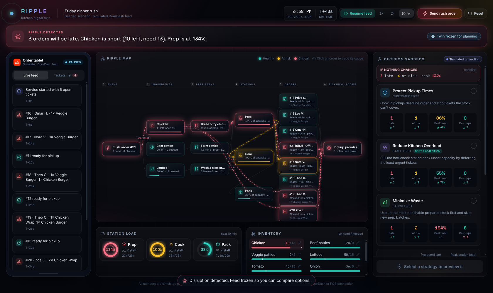

# RIPPLE · Kitchen Digital Twin

> See the ripple effect. Compare your options. Then act.

RIPPLE is a simplified digital twin of a restaurant kitchen. A simulated order feed drives a deterministic model of inventory, prep tasks, stations and pickup promises. When a rush order lands, the **Ripple Map** shows how it spreads (event → ingredient → task → station → order → pickup outcome) and the **Decision Sandbox** compares response strategies side by side before the manager approves one.



All outcomes are **simulated projections**. The order feed is simulated; there is no live DoorDash or POS connection.

## What's in the demo

- **Seeded scenario**: five healthy orders, background orders every 5–8 s, and a guaranteed heavy chicken rush at ~40 s that causes a chicken shortage, Prep above 100% and several late orders.
- **Ripple Map**: fixed-layout cause/effect graph with glowing critical nodes and animated pulses along active edges. Click any order to trace it back to the root cause.
- **Decision Sandbox**: *Protect Pickup Times*, *Reduce Kitchen Overload* and *Minimize Waste*, each with deterministic metrics vs. "no change", a trade-off, and a map preview of what changes. Nothing is applied until you approve.
- **Order tablet**: live feed + tickets, with release/cancel for held orders.
- **Controls**: pause / play, 1×/2×/4× speed, *Send rush order*, stock recount (pencil icon in Inventory), and *Reset* to the exact initial seed.
- **Why panel**: a deterministic explanation. Optionally, Gemini can reword it. Gemini never calculates anything.

## Run locally

Requires Node.js 22.12+ (or 20.19+).

```bash
npm install
npm run dev        # http://localhost:5173
npm test           # deterministic engine tests
npm run build      # type-check + production build into dist/
```

Optional AI wording: create `.env.local` with `GEMINI_API_KEY=...` (never commit it). Without a key, the app uses the deterministic text.

## Project layout

```
src/engine/   seed data, simulation (ingestEvent, tick, project), graph + strategies, tests
src/components/  Ripple Map, Order tablet, Decision Sandbox, vitals, glance bar
src/store.ts  zustand store wiring the engine to the UI
api/explain.ts   Vercel serverless function for optional Gemini wording
server/       dev-server middleware that mirrors /api/explain locally
```

`ingestEvent()` in `src/engine/engine.ts` is the single entry point for orders, rush orders and stock corrections, which is where a real POS or DoorDash webhook would plug in later.

## Connect to GitHub

1. Create an empty repository on GitHub (no README/.gitignore), e.g. `ripple-kitchen-twin`.
2. From this folder:

   ```bash
   git remote add origin https://github.com/<your-username>/ripple-kitchen-twin.git
   git branch -M main
   git push -u origin main
   ```

   Or with the GitHub CLI: `gh repo create ripple-kitchen-twin --public --source=. --push`

## Publish

### Option A: Vercel (recommended, supports the optional AI route)

1. Go to <https://vercel.com/new> and import the GitHub repository.
2. Vercel detects Vite automatically (build `npm run build`, output `dist`). Click **Deploy**.
3. Optional: in *Project → Settings → Environment Variables*, add `GEMINI_API_KEY`, then redeploy.

Every push to `main` redeploys automatically, and pull requests get preview URLs.

### Option B: GitHub Pages (static only, no AI route)

This repo includes `.github/workflows/deploy-pages.yml`.

1. On GitHub: *Settings → Pages → Build and deployment → Source: **GitHub Actions***.
2. Push to `main`. The workflow builds and publishes to `https://<your-username>.github.io/<repo-name>/`.

The "Rephrase with AI" button falls back to deterministic text on Pages, since there is no server.
