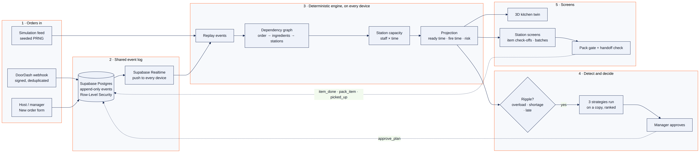
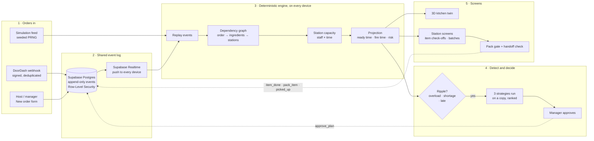
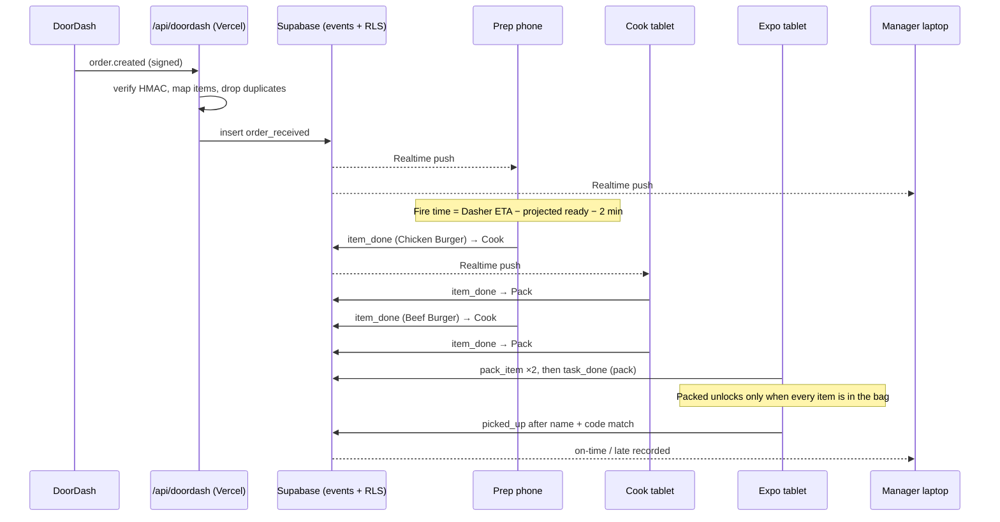

# RIPPLE: technical overview

RIPPLE is a kitchen digital twin. Each order, ingredient, station and pickup is modeled, so the app can show how one event spreads through the kitchen and what to do about it:

```
order / event → ingredient → task / station → order → pickup outcome
```

## How it works





### Life of one DoorDash order



## Technical features

**Simulation and modeling**
- **Deterministic engine:** a seeded PRNG (mulberry32) means the same seed and events always give the same kitchen, so demos and tests can be reproduced.
- **Event sourcing:** the kitchen state is never stored. Every device rebuilds it by replaying an append-only event log, so all devices agree.
- **Dependency graph:** each order links to its ingredients and its Prep → Cook → Pack tasks, so one shortage or overload can be traced to every order it delays.
- **Capacity model:** each station works at staff × minutes per tick. Load % = queued work ÷ capacity.
- **Forward projection:** simulates the queue ahead to give each order its ready time, its risk (on track / at risk / late) and its fire time.
- **Fire-time scheduling:** start time = pickup or Dasher arrival − projected ready time − 2-minute buffer.
- **Ripple detection and strategy comparison:** each of 3 strategies runs on a cloned kitchen, and they're ranked by late orders, at-risk orders and peak load.
- **What-if sandbox (Ask AI):** keyword rules read the question, and the engine plays the scenario out on a copy of the kitchen. AI doesn't calculate anything.

**Kitchen workflow**
- **Item-level routing:** each part of an order moves through Prep → Cook → Pack independently (`itemStage`).
- **Pack gate:** an order can't be ready until every item has arrived at Pack and been ticked off.
- **Cross-order batching:** components shared across tickets at a station are grouped into one action.
- **Handoff check:** a Dasher name and 3-letter code match is required; a mismatch is logged.
- **Manager Board:** drag-and-drop any order to any station (forward or back).
- **Station layout editor:** drag preset stations onto the 3D floor; extra stations add capacity. Placement snaps and avoids overlap.
- **Menu scanning:** Tesseract.js OCR runs in the browser, a parser turns lines into draft dishes (price, likely ingredients, station times), and the manager reviews them before saving.

**Real-time and security**
- **Multi-device sync:** Supabase Realtime (Postgres changes + presence) delivers events in well under a second.
- **Anonymous auth + join codes:** staff join with a 6-character code and pick a role, with no account needed.
- **Role-based access control, enforced twice:** in the client (`roles.ts`) and in the database (`ripple_allowed()` in Row-Level Security policies). For example, a cook can't check off prep, and only managers can edit the layout or the menu.
- **DoorDash webhook:** a Vercel serverless function verifies an HMAC-SHA256 signature with a constant-time compare, ignores repeated deliveries, and writes with the service role key, which stays on the server.
- **Offline / demo fallback:** without Supabase, a local in-browser backend runs the same event log.

**Interface**
- **3D digital twin:** React Three Fiber scene with clickable station nodes, camera fly-to, orbit / zoom / pan, live load labels and drag-to-place stations.
- **Responsive:** desktop three-pane layout (Xcode-style), plus phone and tablet station screens with swipe gestures.
- **Haptics:** the Vibration API on supported devices, with visual snap feedback elsewhere.
- **Explanations:** deterministic text, optionally reworded by Gemini through a server route, so the API key never reaches the browser.

**Quality**
- TypeScript strict, Vitest unit tests (engine, live replay, permissions, DoorDash mapping and signature, menu parser), oxlint, CI deploys from GitHub to Vercel.

## Tech stack

| Layer | Technology |
| --- | --- |
| Languages | TypeScript, TSX, SQL (PostgreSQL), CSS |
| UI framework | React 19 |
| Build / dev server | Vite 8 |
| 3D | Three.js, React Three Fiber, Drei |
| Styling | Tailwind CSS 4 |
| Animation / gestures | Framer Motion |
| Icons | Lucide |
| State | Zustand |
| OCR | Tesseract.js (WebAssembly, runs in the browser) |
| Backend / database | Supabase: PostgreSQL, Row-Level Security, Realtime, Anonymous Auth |
| Serverless API | Vercel Functions (Node.js): DoorDash webhook, Gemini explain route |
| AI (optional) | Google Gemini API (wording only) |
| Browser APIs | WebGL, Vibration API, Web Crypto, Pointer Events, camera capture |
| Testing / linting | Vitest, oxlint, TypeScript compiler |
| Hosting / CI | Vercel (deploys from GitHub), GitHub Actions (Pages workflow) |
| Source control | Git, GitHub |
| Runtime | Node.js 22+ |
